# Salas de oficio de UX

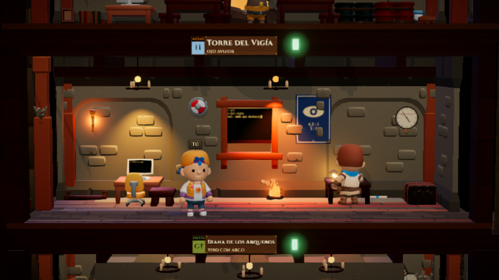

Plantillas de sala que se reclutan en la **Puerta de la Posada** («Contratar un oficio», o ⌘K/Ctrl+K → «Contratar un
oficio de UX»). Cada una trae su aventurero, una carpeta propia en los datos de la app
(`%APPDATA%\work-shelter-public\salas\<id>` en Windows, `~/Library/Application Support/work-shelter-public/salas/<id>`
en macOS) y, dentro:

- `CLAUDE.md`: rol, entregables y criterios de calidad del oficio (más cómo se trabaja en la taberna).
- `.claude/skills/<skill>/SKILL.md`: el oficio paso a paso (Claude Code las carga solas).
- `entregables/`: donde el aventurero deja lo que hace, con fecha en el nombre.

Lo que ya existe en la carpeta no se pisa: si retocas el `CLAUDE.md` o una skill, se queda tu versión (también si
retiras la sala y la vuelves a contratar). Las carpetas de las salas son de confianza para el juego: su configuración
de Claude Code se carga sin preguntar.

| Sala | Aventurero | Oficio | Skills | Acciones rápidas del panel |
|---|---|---|---|---|
| Biblioteca | Aurelia, la Erudita | investigación: guiones, síntesis, personas, journeys | `guion-entrevista`, `sintesis-investigacion`, `personas-journey` | Preparar un guion · Sintetizar notas · Personas y journey |
| Taller | Brunilda, la Artesana | diseño con el MCP de Figma: crítica, variantes, capturas | `critica-diseno`, `variantes-diseno` | Criticar un diseño de Figma · Criticar una captura · Proponer variantes |
| Torre del Vigía | Casiano, el Vigía | auditorías WCAG 2.1 AA | `auditoria-wcag`, `contraste` | Auditar URL · Auditar captura · Comprobar contraste |
| Puerta del Mensajero | Dámaso, el Mensajero | handoff y specs para desarrollo | `spec-handoff`, `criterios-aceptacion` | Spec de una pantalla · Spec desde captura · Criterios de aceptación |
| Armería | Eulogio, el Armero | sistema de diseño: tokens y componentes | `tokens-diseno`, `ficha-componente`, `auditoria-sistema` | Ordenar tokens · Documentar un componente · Auditar consistencia |
| Escenario | Fabricio, el Bardo | UX copy y microcopy | `revisar-textos`, `microcopy` | Revisar textos de esta pantalla · Mensaje de error · Estado vacío · Guía de voz y tono |
| Mesa · *nombre* | Gonzalo, el Senescal | una mesa por cliente o proyecto, con su estandarte | — (su `CLAUDE.md` de contexto, para rellenar) | Completar el contexto · Resumen del estado · Planificar la semana |

Las acciones rápidas abren una conversación con el aventurero. Las que piden un dato (una URL, una pantalla) lo
preguntan antes; las de captura arrancan la conversación y esperan a que pegues la imagen en el intercomunicador.

**Figma.** El Taller usa el servidor MCP de Figma si lo tienes conectado en tu Claude Code; el juego no instala ni
configura ningún MCP en la carpeta. Su `CLAUDE.md` le pide leer (contexto, capturas, metadatos) y no escribir en
Figma sin tu permiso explícito.

**Decorados.** Cada sala trae su escena de serie como datos (`decorado` de la sala, validado por
`shared/decorado.ts`), con muebles, antorchas y carteles del atrezo del juego. Se puede rehacer con «Adaptar la sala»
como cualquier otra.

**Tablón de encargos (Tab).** Todas las conversaciones abiertas de todas las salas: primero las que te esperan (un
permiso, una pregunta, un plan, una avería o algo terminado sin leer), luego las que están en faena.

Código: `shared/oficios.ts` (plantillas), `server/oficios.ts` (carpeta), acción `reclutarOficio` en `server/main.ts`,
`web/src/ui/Oficios.tsx` (Puerta y acciones), `shared/encargos.ts` y `Ocupados` en `web/src/ui/Paneles.tsx` (tablón).
Para añadir un oficio: una entrada más en `PLANTILLAS` (las pruebas de `shared/oficios.test.ts` comprueban decorado,
skills, acciones y que no haya datos reales).

## Capturas

| | |
|---|---|
| 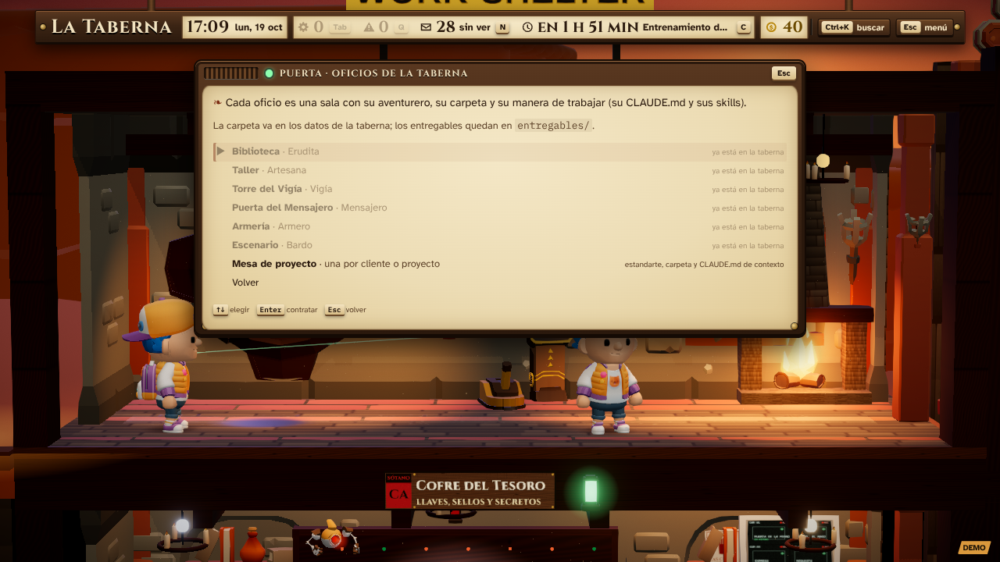 Puerta · Contratar un oficio | 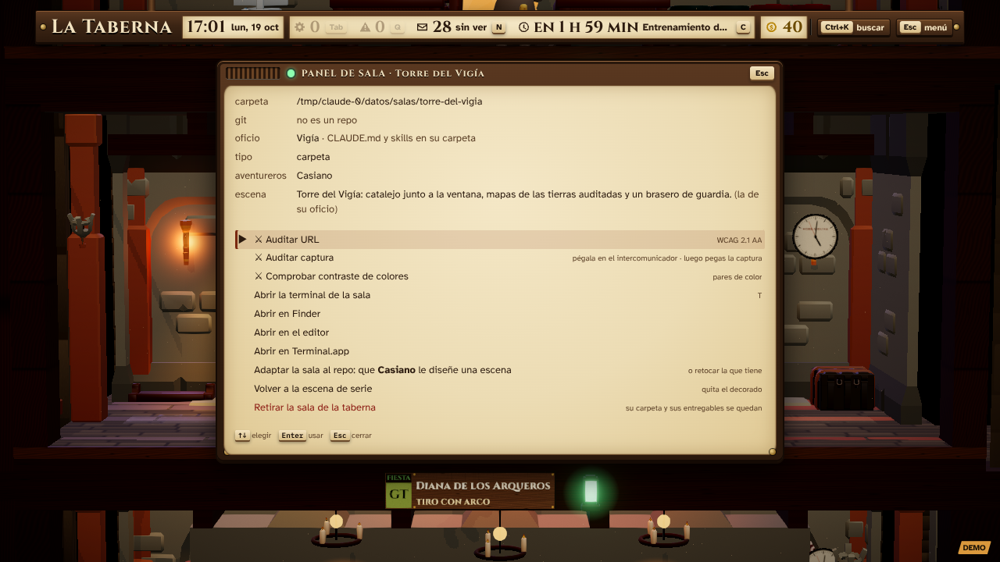 Panel de la Torre del Vigía con sus acciones |
| 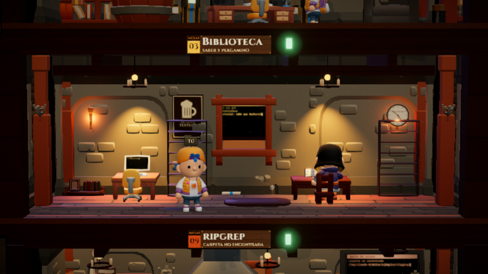 Biblioteca | 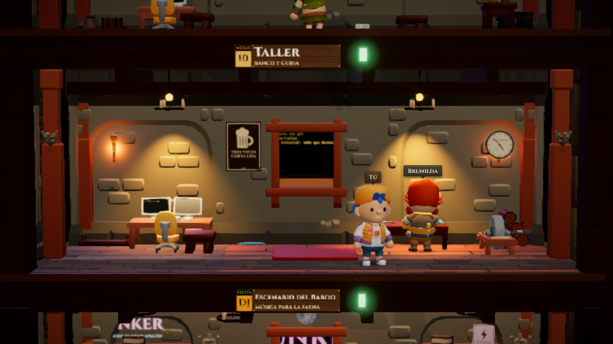 Taller |
| 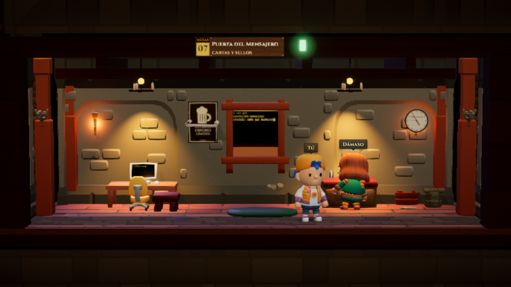 Puerta del Mensajero | 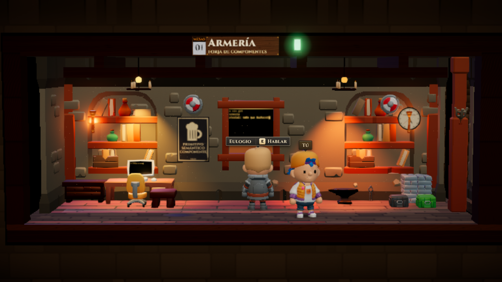 Armería |
| 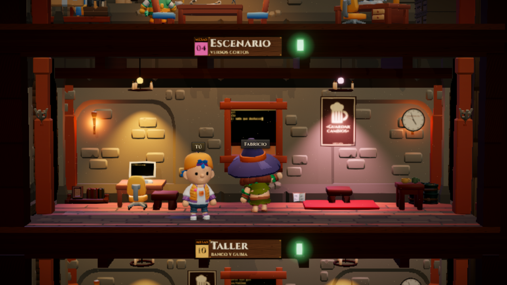 Escenario | 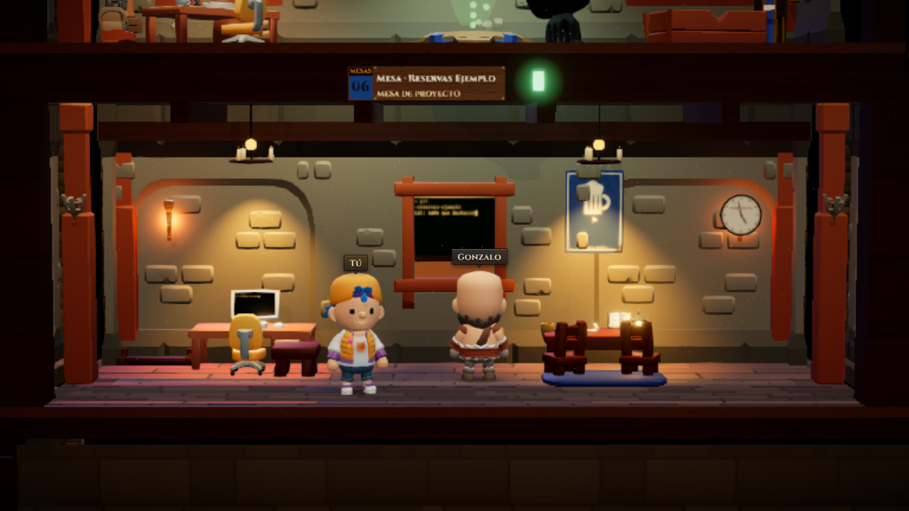 Mesa de proyecto |
| 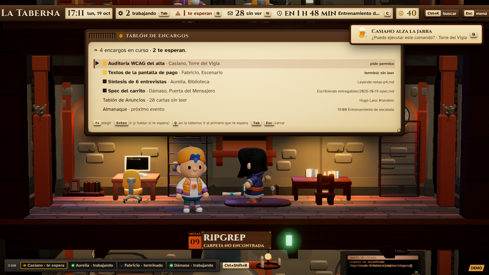 Tablón de encargos (encargos de ejemplo) | 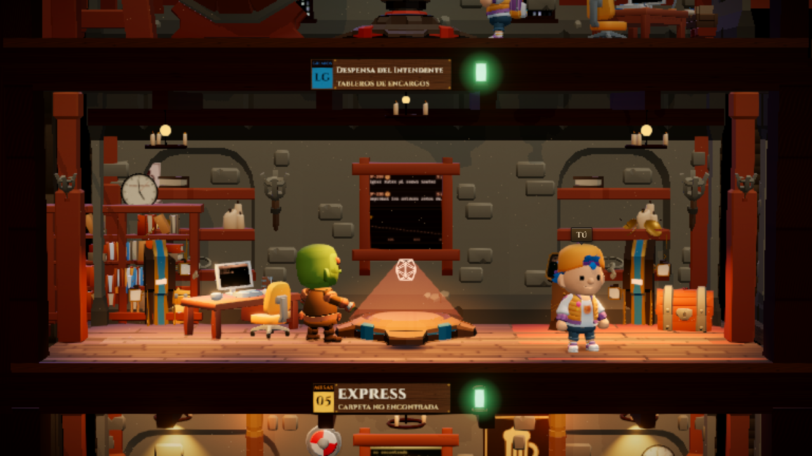 Grisko, el goblin de la despensa |

Capturas hechas en Linux sin GPU (SwiftShader, resolución 0,6) con un refugio de prueba (`SHELTER_DATOS`) y sin
Claude Code: el tablón lleva encargos de ejemplo inyectados en la página.
