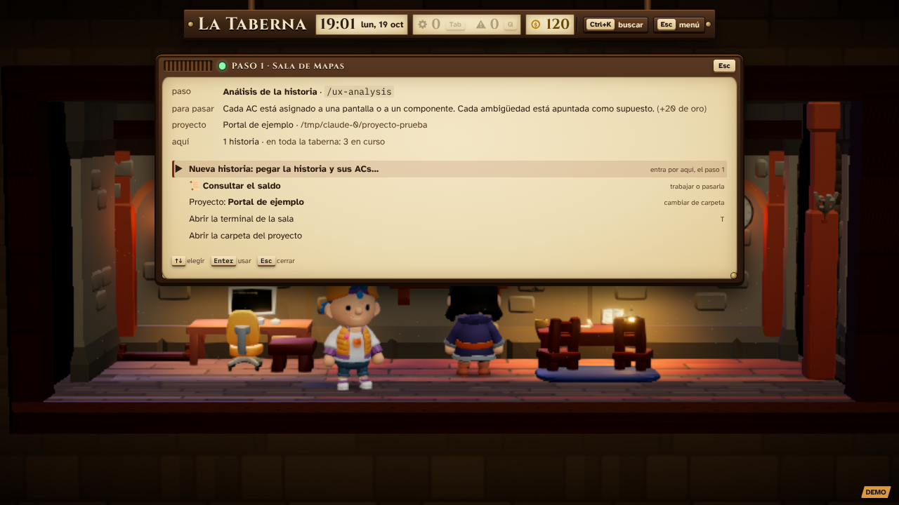
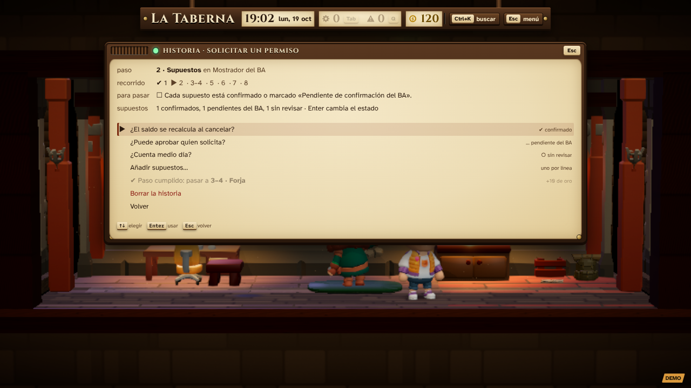
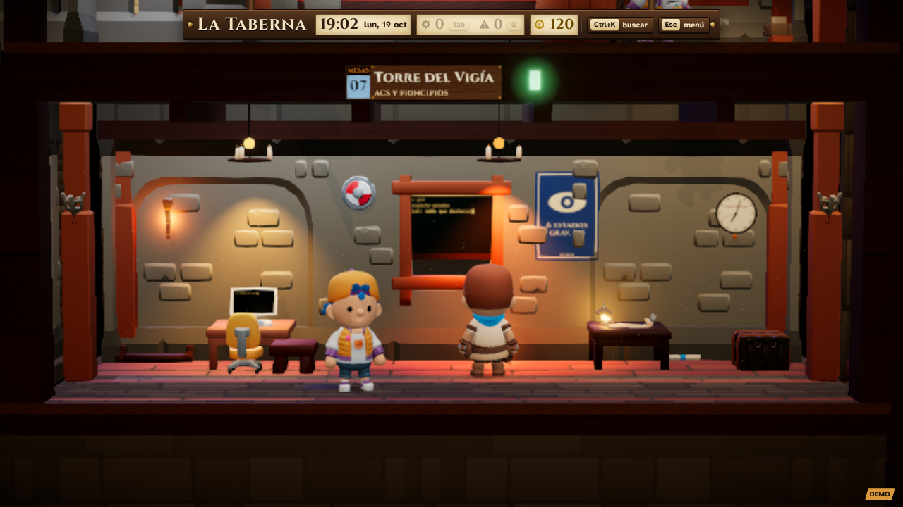
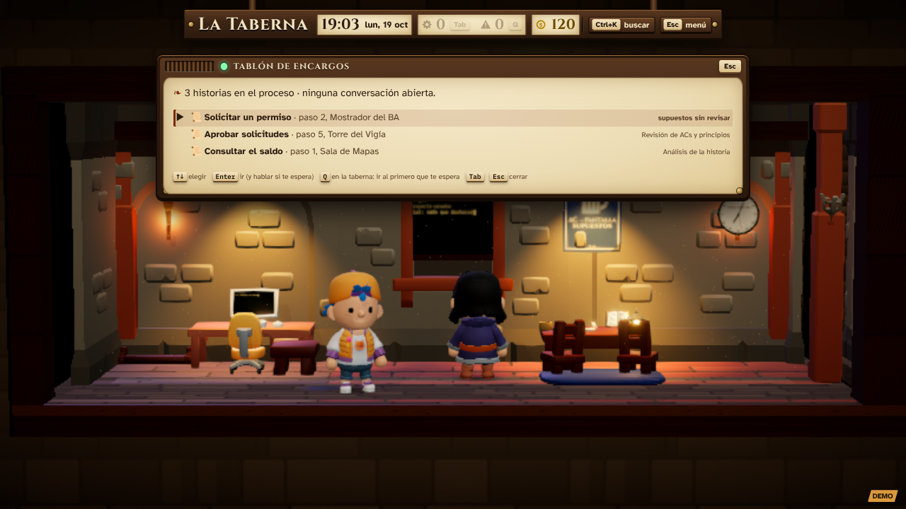
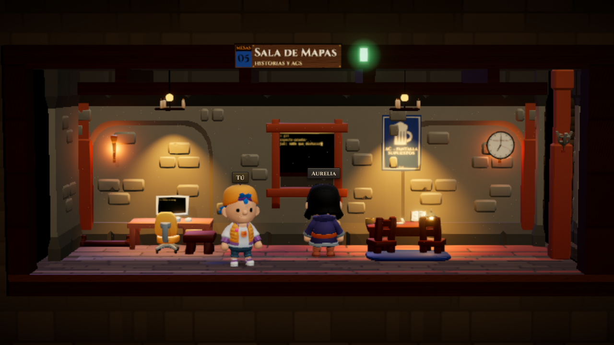
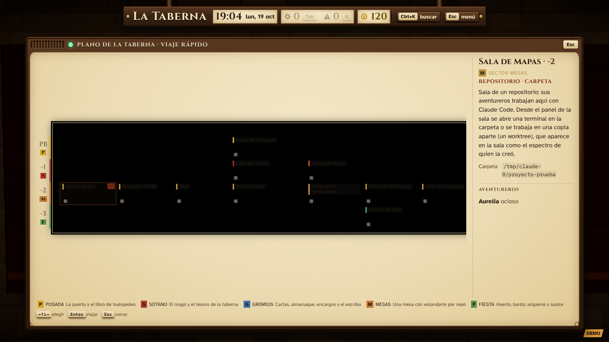

# La taberna del proceso de UX

La taberna es el proceso de trabajo de la Tabernera: **una sala por paso**, en su orden. Cada historia de usuario,
con sus ACs, es un encargo que recorre las salas, de la Sala de Mapas al Libro del Tabernero. Las salas de los pasos
trabajan en la **carpeta del proyecto**, que trae las reglas, el mapa de componentes y las personas, y usan las skills
de la Tabernera, instaladas en su Claude Code. El juego solo nombra sus comandos y no guarda nada del proyecto ni del
cliente.

| Paso | Sala | Qué se hace | Skill | Puerta de calidad para pasar | Oro |
|---|---|---|---|---|---|
| 1 | Sala de Mapas | Se pega la historia y sus ACs: plan de prototipos | `/ux-analysis` (modo plan) | Cada AC asignado a una pantalla o componente; cada ambigüedad, apuntada | 20 |
| 2 | Mostrador del BA | Se apuntan los supuestos y se marcan: confirmado o pendiente del BA | — (a mano) | Ningún supuesto sin revisar | 10 |
| 3–4 | Cocina | El prototipo es el plato: HTML y verificación de su lógica (la cata) | la skill de prototipado del proyecto | Reglas del proyecto cumplidas; consola limpia y validaciones comprobadas | 30 |
| 5 | Torre del Vigía | Revisión de ACs y principios | `/ux-analysis` (modo revisión) | Cada AC con su estado y evidencia; cada hallazgo con gravedad 1–4 | 25 |
| 6 | Comedor de los Peregrinos | Los peregrinos (participantes simulados) prueban el plato | `/ux-testing` | Métricas por tarea y subgrupo | 30 |
| 7 | Puerta del Mensajero | Documentos de handoff para desarrollo y el BA | `/ux-edge-cases` | Cada caso límite sale de una regla; lo no confirmado, como pregunta | 20 |
| 8 | Libro del Tabernero | Registro de la sesión para el tracker | `/session-log` | Cifras y etiquetas que salen de cada paso | 10 |

Cerrar una historia entera da 25 de oro más. El oro de un paso se cobra la primera vez que se cumple: las vueltas por
correcciones no lo repiten.

**Vuelta a la Cocina.** Desde la Torre o el Comedor, «Hay que corregir» manda la historia a la Cocina con los ACs afectados.
La Cocina recibe «corrige solo estos ACs», y la sala de la que vino, «revisa solo estos ACs».

**El oro.** Se gasta en Sastre y Barbero (cada aspecto nuevo cuesta 15) y en la tienda del inventario (I).

**El Tablón de encargos (Tab).** Muestra las historias con su paso, y debajo las conversaciones abiertas.

**El proyecto.** La primera vez, cualquier sala de un paso pide la carpeta del proyecto (una ruta de este equipo). Todas
las salas de los pasos trabajan ahí, y se puede cambiar desde su panel.

**Qué salas hay.** La Puerta de la Posada, el Cofre del Tesoro (ajustes y llaves), el Sótano del Mago (el propio juego),
las siete salas de los pasos y Sastre y Barbero. Una taberna creada antes pierde, una sola vez, las salas que ya no
están: enlace (cartas, agenda, Linear, git), ocio salvo el sastre, repos de ejemplo y salas de oficio.

Código: `shared/pasos.ts` (pasos, prompts, puertas, oro e historias, puro y probado en `shared/pasos.test.ts`),
`web/src/ui/Pasos.tsx` (paneles), acciones `proyecto.elegir` e `historia.*` en `server/main.ts`, y `migrarATabernaUX`
y `ponerProyecto` en `server/estado.ts`.

## Capturas

| | |
|---|---|
|  Sala de Mapas: el paso 1 |  Mostrador del BA: los supuestos, a mano |
|  Torre del Vigía: revisar o volver a la Cocina |  Tablón de encargos con las historias |
|  La Sala de Mapas |  Plano: los siete pasos en fila |

Hechas en Linux sin GPU (SwiftShader) con una taberna y un proyecto de prueba, y sin Claude Code.

## Entregables, oro y decoración

- **Carpeta de la historia.** La primera vez que un aventurero trabaja una historia, propone el nombre de una carpeta nueva dentro del proyecto y espera tu sí. Desde entonces, todo lo de esa historia (planes, prototipo, informes, handoff, registro) va ahí.
- **Mientras trabaja**, sobre su cabeza sale una barra de progreso (estimada: Claude Code no sabe cuánto le falta).
- **Al terminar**, sale un aviso ✔ con lo que ha dejado. «Ver» lo abre dentro del juego: el prototipo (el plato) funciona tal cual, aislado del juego; los documentos Markdown se leen como documento. Todos los entregables de una historia están en su ficha («📜 Entregables»).
- **El oro** se gana cumpliendo pasos. En el panel de cualquier sala de un paso: «Llamar a Gorgo, el buhonero» (trae seis cosas distintas cada día) y «Decorar esta sala» (pones lo del baúl; flechas para moverlo, Q/E para girarlo, Supr lo devuelve al baúl, Enter para acabar). Lo que vendes de vuelta te da la mitad.
